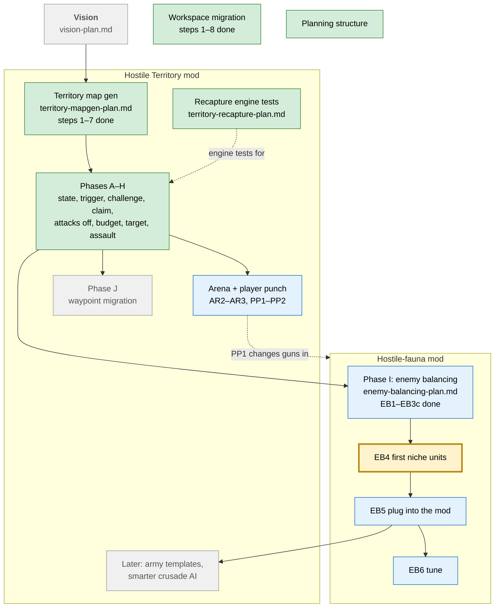

# Roadmap

> The big picture on one page. A summary of the plan files, which stay the source of truth. Last updated: 2026-10-17 (game 2.1.21).
> New ideas go to [inbox.md](inbox.md). How this works: [planning-structure-plan.md](planning-structure-plan.md).

## Where we are

The core loop of Hostile Territory works as a POC: territories on Nauvis (map gen), challenges to take them, crusades to win them back (phases A–H of the vision). Now in **phase I, balancing**: making enemies feel right in the separate mod `Hostile-fauna`. Earth wyrms replaced the demolishers (EB3b) and can be controlled by script (EB3c). **Current focus: EB4, the first niche units.**

## Map

Green: done · Yellow: current focus · Blue: decided, up next · Grey: later or ongoing.

## Plans

| Plan | Topic | Status | Next step |
|------|-------|--------|-----------|
| [vision-plan.md](vision-plan.md) | Overall vision: territory states, challenges, crusades. Phases A–J | A–H done (POC), I in progress | Arena AR2 (decided, not built) |
| [enemy-balancing-plan.md](enemy-balancing-plan.md) | Phase I: enemy feel, speed, niches. Work goes into `mods/Hostile-fauna` | D1–D36 decided, EB1–EB3c done | **EB4: first niche units** |
| [territory-mapgen-plan.md](territory-mapgen-plan.md) | Territories on Nauvis via map gen (the foundation) | Steps 1–7 done | 8 in-game validation |
| [territory-recapture-plan.md](territory-recapture-plan.md) | Engine tests: respawning guardians, territory colour | Tests done, mostly absorbed by phase H | Open questions only |
| [workspace-migration-plan.md](workspace-migration-plan.md) | Monorepo `E:\dev\factorio` | Steps 1–8 done | 9 delete backup (a few days after 2026-10-16), 10 packaging, 11 harness script |
| [planning-structure-plan.md](planning-structure-plan.md) | This roadmap, the inbox, plan headers | Built 2026-10-17 | User review |
| [archive/](archive/) | Old map-gen approach, old overlay bugs | Archived 2026-10-17, don't use | |
| [docs/commands.md](../docs/commands.md) | In-game test commands | Living reference | |

## Open threads, roughly in order

| # | Thread | Plan | Blocked by |
|---|--------|------|------------|
| 1 | **EB4** first niche units (2–3), in-game feel test. Also decides which EB2 test units to promote or remove | enemy-balancing | — |
| 2 | **Arena** AR2 build, AR3 feel test | vision (arena section) | — |
| 3 | **Player punch** PP1 gun damage ×2, PP2 checkpoint table | vision (arena) + enemy-balancing D9/D23 | — |
| 4 | **EB5** use niche units in challenges and crusades, maybe spawners | enemy-balancing | EB4 |
| 5 | **EB6** tune HP, damage, numbers per ring | enemy-balancing | EB5 |
| 6 | Map-gen validation in game (seeds, tiers, terrain) | territory-mapgen step 8 | — |
| 7 | Workspace cleanup, packaging, harness script | workspace-migration 9–11 | 9: wait a few days |
| 8 | Phase J: waypoint migration | vision | Phase I |
| 9 | Later ideas: army templates, smarter crusade AI, play telemetry | vision, enemy-balancing Q1 | EB5 |

## Not yet specified (fog)

Things we know are coming but can't phrase as a clear question yet. When one becomes a question, move it into the open questions of the plan that owns it and delete it here.

| Topic | What we know so far | Likely plan |
|-------|---------------------|-------------|
| Destination of the POC | Phases A–I exist, but there is no line for "playable first version" or a mod portal release | vision |
| Recapture without a crusade | Should territories also turn hostile by timer, pollution or neighbours? Crusades already cover the main case | territory-recapture |
| What changes per challenge ring | More than wave size and tier: more spitters, extra mechanics, "more complicated" challenges (vision 1a) | vision, enemy-balancing |
| Guardian strength | Guardians and rallies are known to be far too strong (H-6), no direction yet | enemy-balancing EB6 |
| Vanilla nests on Nauvis | Do they stay, do they expand, and what about expansion parties that still attack (vision 11a, 12)? | vision |
| Smarter crusade AI | The POC is easy to fool with decoys. Ideas listed, nothing decided ("Later: smarter crusade AI") | vision |
| Army and challenge templates | Unit mixes are hard-coded today. Templates by distance, evolution, territory ("Later: templates") | vision, after EB5 |
| Niches that need script | Skirmisher/kiting (D29 parked), healer/buffer (no data-only way) | enemy-balancing, after EB4 |
| Play telemetry | Collect fight data while playing, to tune effort bands (EB Q1) | enemy-balancing |

## Out of scope

Decided **not** to do. "For now" means it may come back with a new decision; "No" means settled.

| Item | Status | Source |
|------|--------|--------|
| Copying Vulcanus terrain or biomes | No, a separate terrain project | territory-mapgen Goal |
| Old-save support | No, players start a new game | EB D36 |
| Building a staging nest when none exists | No, no nest means no crusade | vision G-3 |
| Scripted regen for guardians and rallies | No | vision H-6 |
| Sea wyrm | For now, earth wyrm first | EB D15, E8 |
| Slow or knockback ammo for the player | For now (gun damage ×2 is in, PP1) | EB D9 |
| Slowing the player in the arena | For now, maybe later | vision AR-a |
| Art for the rally | For now, a white rectangle placeholder | vision H (7c) |
| Remote building triggering a challenge | For now, plain vanilla in the POC | vision Q5a |

## Issues across plans

Found while building this roadmap (2026-10-17). Fixed ones are struck through.

| # | Issue | Where |
|---|-------|-------|
| R1 | ~~Two outdated plans next to active ones.~~ Moved to `plans/archive/` (2026-10-17). | |
| R2 | ~~`plan.md` too broad a name, outdated Decisions.~~ Renamed to `territory-mapgen-plan.md`, Decisions updated (2026-10-17). | |
| R3 | ~~Stale second `## Open questions` block (AR-a … PP-c).~~ Deleted (2026-10-17). | |
| R4 | ~~`test-plan.md` duplicates `docs/commands.md`.~~ Removed by user (2026-10-17). | |
| R5 | ~~EB2 unchecked though done.~~ Ticked (2026-10-17); test units stay until EB4. | |
| R6 | ~~Outdated "recapture needs control.lua" note.~~ Marked as answered (2026-10-17). | |
