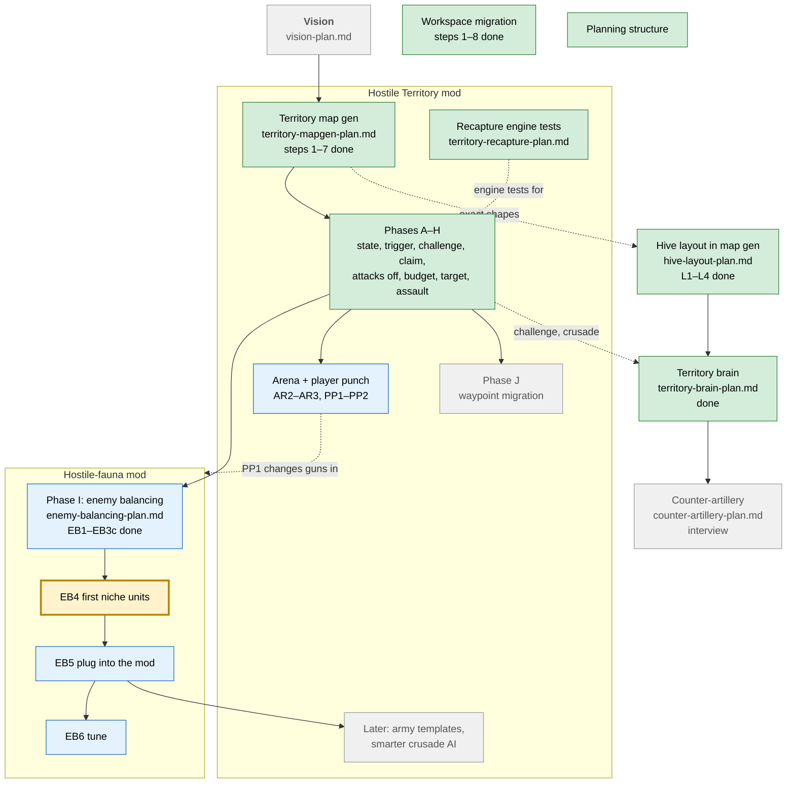

# Roadmap

> The big picture on one page. A summary of the plan files, which stay the source of truth. Last updated: 2026-10-17 (game 2.1.21).
> New ideas go to [inbox.md](inbox.md). How this works: [planning-structure-plan.md](planning-structure-plan.md).

## Where we are

The core loop of Hostile Territory works as a POC: territories on Nauvis (map gen), challenges to take them, crusades to win them back (phases A–H of the vision). Now in **phase I, balancing**: making enemies feel right in the separate mod `Hostile-fauna`. Earth wyrms replaced the demolishers (EB3b) and can be controlled by script (EB3c). Since 2026-10-17 every territory has **one brain base**, and its **brain** (a standing-still segmented unit) is the guardian; bases regrow, water territories start claimed (territory-brain-plan.md). **Current focus: EB4, the first niche units.**

## Map

Green: done · Yellow: current focus · Blue: decided, up next · Grey: later or ongoing.

## Plans

| Plan | Topic | Status | Next step |
|------|-------|--------|-----------|
| [vision-plan.md](vision-plan.md) | Overall vision: territory states, challenges, crusades. Phases A–J | A–H done (POC), I in progress | Arena AR2 (decided, not built) |
| [enemy-balancing-plan.md](enemy-balancing-plan.md) | Phase I: enemy feel, speed, niches. Work goes into `mods/Hostile-fauna` | D1–D36 decided, EB1–EB3c done | **EB4: first niche units** |
| [territory-mapgen-plan.md](territory-mapgen-plan.md) | Territories on Nauvis via map gen (the foundation) | Steps 1–7 done | 8 in-game validation |
| [territory-recapture-plan.md](territory-recapture-plan.md) | Engine tests: respawning guardians, territory colour | Tests done, mostly absorbed by phase H | Open questions only |
| [workspace-migration-plan.md](workspace-migration-plan.md) | Monorepo `E:\dev\factorio` | Steps 1–8 done | 9 delete backup (a few days after 2026-10-16), 10 packaging, 11 harness script |
| [territory-brain-plan.md](territory-brain-plan.md) | Move L4 into the mods: brain as guardian, one brain base per territory, water → claimed, regrowth | Done 2026-10-17 (B1–B6), confirmed in game. Open notes B-I10–B-I12 (brain seen before its base, brain too strong, crusades maybe slower) | None; brain strength → EB6 |
| [hive-layout-plan.md](hive-layout-plan.md) | Can map gen make exact base shapes (worm in the middle, ring of nests)? | L1–L4 done 2026-10-17: worm core + nest ring per base (L3), one base per territory from our own points (L4), both confirmed in game | Done; continues in territory-brain-plan.md |
| [counter-artillery-plan.md](counter-artillery-plan.md) | Hive counter units shoot player artillery shells mid-flight; 30 s recharge, count by challenge level. Artillery cheese on the brain is "sort of acceptable" until then | Interview: CA-D1–D8 decided 2026-10-17, nothing built | Open questions, then CA1 fire-event test |
| [planning-structure-plan.md](planning-structure-plan.md) | This roadmap, the inbox, plan headers | Built 2026-10-17 | User review |
| [archive/](archive/) | Old map-gen approach, old overlay bugs | Archived 2026-10-17, don't use | |
| [docs/commands.md](../docs/commands.md) | In-game test commands | Living reference | |

## Open threads, roughly in order

| # | Thread | Plan | Blocked by |
|---|--------|------|------------|
| 1 | **EB4** first niche units (2–3), in-game feel test. Also decides which EB2 test units to promote or remove | enemy-balancing | — |
| 2 | **Arena** AR2 build, AR3 feel test | vision (arena section) | — |
| 3 | **Player punch** PP1 gun damage ×2, PP2 checkpoint table | vision (arena) + enemy-balancing D9/D23 | — |
| 4 | **EB5** use niche units in challenges and crusades, maybe spawners | enemy-balancing | EB4 |
| 5 | **EB6** tune HP, damage, numbers per ring | enemy-balancing | EB5 |
| 6 | Map-gen validation in game (seeds, tiers, terrain) | territory-mapgen step 8 | — |
| 7 | Workspace cleanup, packaging, harness script | workspace-migration 9–11 | 9: wait a few days |
| 8 | Phase J: waypoint migration | vision | Phase I |
| 9 | Later ideas: army templates, smarter crusade AI, play telemetry | vision, enemy-balancing Q1 | EB5 |

## Not yet specified (fog)

Things we know are coming but can't phrase as a clear question yet. When one becomes a question, move it into the open questions of the plan that owns it and delete it here.

| Topic | What we know so far | Likely plan |
|-------|---------------------|-------------|
| Destination of the POC | Phases A–I exist, but there is no line for "playable first version" or a mod portal release | vision |
| Recapture without a crusade | Should territories also turn hostile by timer, pollution or neighbours? Crusades already cover the main case | territory-recapture |
| What changes per challenge ring | More than wave size and tier: more spitters, extra mechanics, "more complicated" challenges (vision 1a) | vision, enemy-balancing |
| Guardian strength | Guardians and rallies are known to be far too strong (H-6), no direction yet. The head-only brain is much harder to kill than the wyrm was (territory-brain B4, 2026-10-17); medium and big brains out-regenerate railgun and nukes (B-I11): tweak later | enemy-balancing EB6 |
| Vanilla nests on Nauvis | Placement decided: our map-gen patterns replace vanilla nest and worm autoplace ([hive-layout-plan.md](hive-layout-plan.md) L-c, 2026-10-17). Still open: do bases expand, and what about expansion parties that still attack (vision 11a, 12)? | vision |
| Smarter crusade AI | The POC is easy to fool with decoys. Ideas listed, nothing decided ("Later: smarter crusade AI") | vision |
| Army and challenge templates | Unit mixes are hard-coded today. Templates by distance, evolution, territory ("Later: templates") | vision, after EB5 |
| Niches that need script | Skirmisher/kiting (D29 parked), healer/buffer (no data-only way) | enemy-balancing, after EB4 |
| Play telemetry | Collect fight data while playing, to tune effort bands (EB Q1) | enemy-balancing |
| Territory brain (hive) | Build part → [territory-brain-plan.md](territory-brain-plan.md) (brain, bases, water, regrowth). Still fog here: new challenge trigger, "dumb" units after the brain dies. Every territory gets its own brain, and **the brain is the guardian**. One base per territory: the brain base, no other enemy bases ([hive-layout-plan.md](hive-layout-plan.md) L-b). Killing it wins the territory. The challenge starts when you get close to the brain or attack structures near it. Brain dead → no challenge AI and no crusade AI from that territory (the hard part is making challenge and crusade feel smart, not making "dumb" feel dumb). A crusade carries a small mobile brain unit, which grows into a stationary brain at the rally spot when the crusade wins. Shield units guard the static brain, or the brain unit while a crusade carries it. Wyrms were a POC guardian and may not stay guardians. Engine: a dormant `segmented-unit` (speeds 0) stands still in its territory and fights back (EB3c C1). Open: a head with 0–1 segments and a brain sprite (untested; docs only give max 63 segments). From inbox 2026-10-17 | vision |
| Hive base layout | Map-gen part → [hive-layout-plan.md](hive-layout-plan.md). One central building (the brain) with buildings around it. No walls (they'd block the enemy AI more than the player). The challenge starts when the player gets "close enough", and what that means depends on the layout. Engine levers (2.1.21 docs; (1) proven by L1–L3): (1) **map gen**: spawner/worm `autoplace` with a noise expression; `voronoi_spot_noise` with the same input, seed, grid and jitter as our territory `voronoi_cell_id` should give the distance to the territory centre, which allows rings; (2) **script layout**: `create_entity` + `can_place_entity` / `find_non_colliding_position` once the centre chunk is generated (`on_chunk_generated`, `request_to_generate_chunks`); (3) **growth over time**: script adds buildings one by one (fits the crusade's growing brain). **Decided: bases regrow over time** after a won crusade, since map gen builds a base only once (user, 2026-10-17, hive-layout L-i3); (4) **engine expansion**: `build_enemy_base` / `build_base` command, `on_biter_base_built` returns what got built so script can swap it; (5) **ground**: `set_tiles`, `create_decoratives`, spawner `spawn_decoration` for creep that thickens towards the core | vision, with territory brain |
| Free territories as crusade targets | Territories whose brain can't be placed (point on water) start **claimed** with no base ([hive-layout-plan.md](hive-layout-plan.md) L-i). Crusades target the **furthest** claimed territory and cost more with distance (`crusade.lua`), so far-out free territories become the first targets, a decoy far from the base. Unsure how to handle (user, 2026-10-17). Softened (B4, 2026-10-17): a water territory only turns claimed once the player explores the chunk with its point, so crusades only go after explored ones. User dislikes the "claimed only after exploring" behaviour but accepts it for now. | vision, smarter crusade AI |

## Out of scope

Decided **not** to do. "For now" means it may come back with a new decision; "No" means settled.

| Item | Status | Source |
|------|--------|--------|
| Copying Vulcanus terrain or biomes | No, a separate terrain project | territory-mapgen Goal |
| Old-save support | No, players start a new game | EB D36 |
| Building a staging nest when none exists | No, no nest means no crusade | vision G-3 |
| Scripted regen for guardians and rallies | No | vision H-6 |
| Sea wyrm | For now, earth wyrm first | EB D15, E8 |
| Slow or knockback ammo for the player | For now (gun damage ×2 is in, PP1) | EB D9 |
| Slowing the player in the arena | For now, maybe later | vision AR-a |
| Art for the rally | For now, a white rectangle placeholder | vision H (7c) |
| Remote building triggering a challenge | For now, plain vanilla in the POC | vision Q5a |

## Issues across plans

Found while building this roadmap (2026-10-17). Fixed ones are struck through.

| # | Issue | Where |
|---|-------|-------|
| R1 | ~~Two outdated plans next to active ones.~~ Moved to `plans/archive/` (2026-10-17). | |
| R2 | ~~`plan.md` too broad a name, outdated Decisions.~~ Renamed to `territory-mapgen-plan.md`, Decisions updated (2026-10-17). | |
| R3 | ~~Stale second `## Open questions` block (AR-a … PP-c).~~ Deleted (2026-10-17). | |
| R4 | ~~`test-plan.md` duplicates `docs/commands.md`.~~ Removed by user (2026-10-17). | |
| R5 | ~~EB2 unchecked though done.~~ Ticked (2026-10-17); test units stay until EB4. | |
| R6 | ~~Outdated "recapture needs control.lua" note.~~ Marked as answered (2026-10-17). | |
